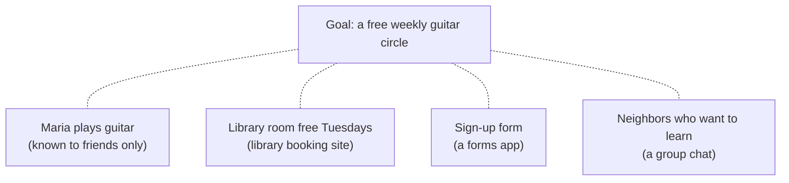
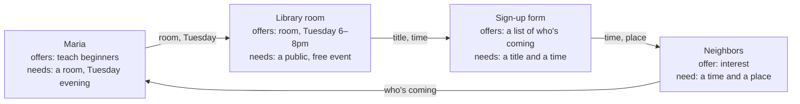

# /technology: page design

**Status:** design for founder review, 2026-10-20. Not page copy; wording below is placeholder. Builds on `openspec/changes/public-pages/design.md` (essay files, named blocks drawn in the browser, static fallbacks, web only).

## 1. The atlas's five dimensions, made concrete

| Dimension | What the page does | Block(s) | First version? |
| --- | --- | --- | --- |
| More interactive | One worked example (§3) the reader opens step by step: the goal, the pieces, how they combine, where one step is refused. Hand-authored; no picker, no solver. This cuts the atlas sketch ("choose a goal and a few people/software/resources; combine them"); a picker would be a small explorer inside an essay, which the public-pages design rules out. Q13 puts the cut to you. | `expandable` per step | Yes |
| More beautiful | One diagram in two panels: today's silos, and a proposed composed path (§2). Plain boxes and arrows in the brand palette; no decorative network art. | `diagram` (Mermaid) ×2 with written descriptions | Yes |
| More meaningful | Says what would have to be represented for composition to work (goals, needs, offers, permissions, constraints, commitments) and why it fails: blocks that don't fit, trust, and computation that grows too fast. | prose + `evidence` cards | Yes |
| Participatory / MVP link | Three open engineering questions (§5), each naming the skills that help and a contact route; one links to a `/roadmap` item. | prose, links | Yes |
| More dataful | A status table (Shipped / planned engineering / open question / speculative direction, as mapped in `research.md`), and the toy example's input/output trace. Runtime, memory and failure data only once something real is measured. | `table` ×2 | Status table yes; trace inside the example |

The page breaks no non-goal in the public-pages design: no explorer inside the essay, no live data, no interest vote.

## 2. Diagram: today's silos vs a proposed composed path

Two `diagram` blocks, stacked on phones and side by side on wide screens, each with a written description that is also the static fallback. Labels are words, never color alone. The atlas asks for a toggle; the block list has none, so this design uses two panels (questions.md Q7).

**Panel A, "Today: separate places"** (placeholder Mermaid):

Description: "Four things that could make the circle happen each live somewhere different. Nothing connects them, so someone has to know about all four and join them by hand."

**Panel B, "Proposed: pieces that say what they need and offer"**:

Description: "Each piece says what it offers and what it needs. Where one's offer matches another's need, they connect, and a path to the goal appears. This is a drawing of an idea; It does not do this today."

## 3. Toy composability example (hand-authored, not a working solver)

The page says so in its first line: "We wrote this example by hand to show the idea. No program found this path."

Shown as an `expandable` per step and a `table` trace. The people and places are invented and are labelled as invented; no real person's data.

**Blocks in the example** (each needs, offers, permission):

| Block | Kind | Offers | Needs | Permission |
| --- | --- | --- | --- | --- |
| Maria | person, skill | teach beginner guitar, 1 evening a week | a room; a fixed weekday | her contact details shared only with people who sign up |
| Library room | resource | room for 12, Tuesdays 6–8pm | event is free and open to the public | booking by a library card holder |
| Sign-up form | software | a list of attendees | title, time, place | attendees' emails visible to the organizer only |
| Neighbors | people | interest from 7 people | a time and place they can make | none shared until they sign up |
| Commitment | commitment | "Maria hosts for four Tuesdays" | Maria agrees | revocable by Maria |

**Trace** (inputs → outputs, one row per step):

| Step | Input | Combine | Output | Status |
| --- | --- | --- | --- | --- |
| 1 | Goal "free weekly guitar circle" | look for blocks that offer "teach guitar" | Maria | matched |
| 2 | Maria needs a room on a weekday | look for a room offer with a weekday | Library room, Tuesday | matched; the library's "free and public" need is met by the goal |
| 3 | Room booking needs a card holder | Maria has a card | booking request | matched |
| 4 | Event needs a list of who's coming | Sign-up form, given title, time, place | form link | matched |
| 5 | Send Maria's phone number to the neighbors | check Maria's permission | **refused**: only shared with people who sign up | the path reroutes: neighbors get the form link, not her number |
| 6 | Neighbors sign up | form shares attendee list with organizer | Maria sees 7 names | matched |
| 7 | Maria commits to four Tuesdays | record a revocable commitment | a path to the goal | complete |

**What the example deliberately shows:** a permission changing the path (step 5), a commitment as its own block (step 7), and that every step is a check a person could follow.

**What it hides, said on the page:** someone had to describe every block in the same words ("Tuesday", "room"); with real providers they won't match (open question 2). With thousands of blocks, trying combinations grows very fast (open question 3). Trust in Maria isn't represented at all.

Atlas link to It: the goal could be a way under the loneliness pain ("Start a group", kind **New group**), so the example reads as the next step after the explorer. Confirm in Q6.

## 4. Start small (first version)

The atlas's own minimum is smaller: "One diagram with an accessible toggle between 'today's silos' and 'a proposed composed path,' plus three open engineering questions." The list below adds the status table, the toy example and evidence cards, because the atlas guardrail (implemented vs research goal) needs the table and the example is the page's "explore one thing". Q14 offers the atlas minimum instead.

1. About 500 words from `outline.md`.
2. The two-panel diagram (§2).
3. The status table, labelled Shipped / planned engineering / open question / speculative direction, filled from `research.md` "What the repo implements". Each row links to the file or decision record that proves it.
4. The toy example as expandables plus its trace table (§3).
5. Three open questions (§5), one linked to `/roadmap`, each with "skills that help" and the contact route.
6. Two or three `evidence` cards: planning complexity (Bylander 1994), object capabilities (Miller 2006), and one interoperability standard.

Not in the first version: an interactive picker, live data, measured performance, math notation (unless Q11 says otherwise).

Blocks used: `diagram` ×2, `table` ×2, `expandable` ×7 or one `expandable` holding the whole example, `evidence` ×2–3. All exist in the public-pages block list; nothing new is needed.

## 5. Three open engineering questions

Each is labelled **open question** on the page, and each carries one of the atlas's §9 contribution requests as a concrete task a stranger can do without asking the founder.

1. **Permissions that survive composition.** When two blocks combine, the result can reveal what one of them was allowed to keep private ("seven people signed up for Tuesday" reveals that each of them did). How should a permission be represented so a derived result keeps the restrictions of what it came from? Prior work: object capabilities and attenuated delegation (UCAN, Macaroons) handle *who may act*; they say less about *what a result may reveal*. **Task (atlas §9): review a candidate way to represent permissions and resources.** The candidate is the toy example's Permission column (§3): find a combination of its blocks whose output reveals something a permission was meant to keep private. Skills: security, formal methods.
2. **Knowing when two blocks fit.** Different providers describe the same thing differently ("Tuesday 6pm", an iCalendar event, a free/busy slot). When is an offer close enough to a need, and who decides? The planned Thing / Type / Relation layer (recorded equivalences rather than merges, links as claims with confidence) is one small answer for content. **Candidate `/roadmap` link:** that layer is decided and scheduled after launch. **Task (atlas §9): test an interface edge case.** Take two real descriptions of the same time slot (for example an iCalendar event and a calendar free/busy reply) and show where the toy example's "Tuesday 6–8pm" would fail to match one of them. Skills: standards, data modeling, interface design.
3. **Finding paths within budgets.** Plan-finding from parts is PSPACE-complete in general (Bylander 1994). What restricted shape keeps it useful: curated recipes refined step by step (as in hierarchical task network planning), bounded depth, or partial answers with a reason when no path is found? How should a person see "no path found within this budget" without mistaking it for "impossible"? **Task (atlas §9): provide a scaling counterexample.** Describe a small family of blocks where the number of combinations to check grows exponentially as blocks are added, or show that a restriction proposed here doesn't prevent that. Skills: distributed systems, algorithms, interface design.

## 6. Accessibility and honesty checks

- Both diagrams carry a written description that stands alone with scripts off.
- The toy example is plain text and tables; expandables announce state and work by keyboard (public-essays spec).
- Every status row is a word label, never color alone.
- No figures about It. If a reader could mistake the example for a feature, the first sentence of the example rules that out.
