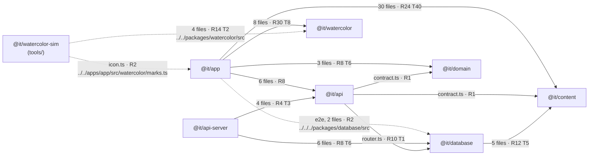

# Inventory of schemas, types, and package dependencies

Research for wayfinder ticket #141 (map #140). Read from `master` at `1dced8f` on 2026-10-21. Facts only; the schemas ticket (#147) decides what to change. Background on the options is in #145 ([schema-layering.md](https://github.com/weareit-app/weareit/blob/research/schema-layering/docs/research/wayfinder/schema-layering.md)).

## How this was gathered

A script walked every tracked `.ts`, `.tsx`, and `.mts` file (254 files) with the TypeScript 5.9.3 parser. For each import of a workspace module (a `@it/*` package name, an `@/` alias, or a relative path), it recorded each imported name and resolved the target file through the package's `exports` map. An import counts as:

- **type-only** when it is written `import type` or `type X`, or when a value import is used only in type positions (for example `typeof helpInterestIds`);
- **runtime** otherwise.

Zod schemas are top-level `const` declarations whose initializer starts from `z` or from another schema. Values made by calling `.parse()` on hand-written data (`fixes`, `firstActions`, `personalPainDomains`, `worldPainDomains`, and the four palettes in `@it/watercolor`) are data, not schemas. Dynamic `import()` calls and `export { … }` lists were checked by hand: there is one cross-package dynamic import (below) and one re-export list, in `essay-schema.ts`.

Schemas written inline inside the API contract (procedure inputs and outputs) are listed with the contract, not one by one.

## Short answer

- **Packages and their real edges** match what each `package.json` declares, with three exceptions, all relative paths: two Playwright specs in `apps/app/e2e` import `packages/database/src/tier1-import`, and `tools/watercolor-sim` imports `packages/watercolor/src/*` and `apps/app/src/watercolor/marks.ts` instead of using its declared `@it/watercolor` dependency.
- **The app's type graph reaches `@it/database`.** `apps/app` imports `@it/api/client` at runtime; `client.ts` imports `type ApiRouter` from `./router`; `router.ts` imports `@it/database/content-repository` and `@it/database/database`, which bring in `kysely` and `pg` types. Nothing from `@it/database` is bundled into the app, because the `router` import is type-only.
- **Zod lives in four packages and one app.** `@it/content` has 47 schemas (essay schemas, the content graph, and the authoring schemas behind the tier-1 data), `@it/api` has 5 named schemas plus inline ones in the contract, `@it/domain` has 3, `@it/watercolor` has 4, and `apps/api-server` has one webhook schema. `@it/database` has none: its Kysely table types are written by hand.
- **Unused export entries:** `@it/api/contract`, `@it/content/schema`, `@it/content/credits`, `@it/database/types`, `@it/database/tier1-import`, `@it/watercolor/pigment`, and `@it/watercolor/mix` are imported by package name from nowhere. `tier1-import` is reached only by the relative path from the e2e specs.
- **The same shape is written more than once in 15 places.** The largest: support frequency is spelled out in 8 places and support status in 5; every content enum is written in the graph schema, again in the Kysely table types, and again in the SQL checks; the slug ID pattern is repeated 5 times; and the tier-1 authoring schemas overlap the content graph schemas field by field.

## Package dependency graph

Arrows point from importer to imported. Counts are files that import across the edge; "R" and "T" count imported names that are runtime or type-only. Dashed edges are relative-path imports with no package name.

`@it/content`, `@it/domain`, and `@it/watercolor` import no workspace package. All three depend only on `zod` at runtime.

### Edges in detail

| From | To | Through | Runtime or type-only |
| --- | --- | --- | --- |
| `@it/app` | `@it/api` | `./client` (`apiClient`, `describeApiFailure`, `setCmsToken`, `setSessionCookieProvider`) | runtime |
| `@it/app` | `@it/api` (type graph only) | `client.ts` → `import type { ApiRouter } from "./router"` → `@it/database/*` → `kysely`, `pg` | type-only |
| `@it/app` | `@it/content` | `./graph-schema`, `./essay-schema`, `./essays`, `./essay-drafts`, `./tier-1`, `./fixes`, `./first-actions` | both; schemas used at runtime are `calendarDateSchema`, `essaySourceSchema`, and `blockSchemas` |
| `@it/app` | `@it/domain` | `./onboarding` | both; `onboardingDraftSchema` at runtime (persisted-store rehydration) |
| `@it/app` | `@it/watercolor` | `./shaders`, `./motion`, `./palettes`, `./manifest`, `./gather` | both; `manifestSchema` at runtime |
| `@it/app` (e2e) | `@it/database` | `apps/app/e2e/onboarding.spec.ts` and `watercolor.spec.ts`: `../../../packages/database/src/tier1-import` (`buildTier1ContentGraph`) | runtime, not declared in `package.json` |
| `@it/api-server` | `@it/api` | `./router` (`createApiRouter`, `ApiContext`, `ApiRouter`); `./openapi` by dynamic `import()` in `api-docs.ts` | runtime and type-only |
| `@it/api-server` | `@it/database` | `./database`, `./readiness`, `./support-repository` | runtime and type-only |
| `@it/api` | `@it/database` | `router.ts`: `./content-repository` (10 functions and error classes), `type ItDatabase` from `./database` | runtime |
| `@it/api` | `@it/content` | `contract.ts`: `contentGraphSchema` | runtime |
| `@it/api` | `@it/domain` | `contract.ts`: `onboardingDraftSchema` | runtime |
| `@it/database` | `@it/content` | `./graph-schema` (`contentGraphSchema`, three status helpers, `ContentGraph`, `FeatureStatus`), `./tier-1`, `./fixes`, `./first-actions` | runtime and type-only |
| `@it/watercolor-sim` | `@it/watercolor` | `../../packages/watercolor/src/{manifest,palettes,shaders/index,mix,pigment}.ts` | runtime; declared dependency is unused by name |
| `@it/watercolor-sim` | `@it/app` | `icon.ts`: `../../apps/app/src/watercolor/marks.ts` (`IT_MARK`, `WE_ARE_IT_MARK`) | runtime, not declared |

Inside `@it/api`, `contract.ts` imports no server code; `router.ts` imports `contract.ts` and `@it/database`; `client.ts` imports `router.ts` as a type; `openapi.ts` imports `contract.ts`.

### Export entries and who uses them by package name

| Package | Entry | Imported by name from |
| --- | --- | --- |
| `@it/api` | `./client` | `@it/app` |
| | `./router` | `@it/api-server` |
| | `./openapi` | `@it/api-server` (dynamic `import()`) |
| | `./contract` | nowhere outside the package |
| `@it/content` | `./graph-schema` | `@it/app`, `@it/database`, `@it/api` |
| | `./essay-schema` | `@it/app` |
| | `./tier-1`, `./fixes`, `./first-actions` | `@it/app`, `@it/database` |
| | `./essays`, `./essay-drafts` | `@it/app` |
| | `./schema`, `./credits` | nowhere outside the package |
| `@it/database` | `./database` | `@it/api`, `@it/api-server` |
| | `./content-repository` | `@it/api` |
| | `./support-repository`, `./readiness` | `@it/api-server` |
| | `./types`, `./tier1-import` | nowhere by name (`tier1-import` by relative path from e2e) |
| `@it/domain` | `./onboarding` | `@it/app`, `@it/api` |
| `@it/watercolor` | `./shaders`, `./motion`, `./palettes`, `./manifest`, `./gather` | `@it/app` |
| | `./pigment`, `./mix` | nowhere by name (`tools/watercolor-sim` by relative path) |

## Zod schemas

Every top-level schema. "Exported" means exported from its file; whether the file is a package entry is in the table above.

| Package | File | Schemas (exported in **bold**) |
| --- | --- | --- |
| `@it/api` | `src/contract.ts` | `publishedContentSchema`, `draftSchema`, `validationSchema`, `publishSchema`, `versionSchema`, plus inline input and output schemas on 12 procedures |
| `@it/content` | `src/graph-schema.ts` | `idSchema`, `copySchema`, **`calendarDateSchema`**, **`contentDomainSchema`**, **`contentPainSchema`**, **`contentDreamSchema`**, **`contentFirstActionSchema`**, **`contentFixSchema`**, **`contentRoadmapItemSchema`**, **`contentSourceSchema`**, **`contentProvenanceSchema`**, **`contentGraphSchema`** |
| | `src/schema.ts` | `contentIdSchema`, `copySchema`, **`dreamSchema`**, **`painSchema`**, **`painDomainSchema`**, **`painDomainListSchema`** |
| | `src/fixes.ts` | `fixSchema`, `fixListSchema` |
| | `src/first-actions.ts` | `firstActionSchema`, `firstActionListSchema` |
| | `src/essay-schema.ts` | **`essaySourceSchema`**, **`essayChangeSchema`**, **`essayFrontMatterSchema`**, `inlineSchema`, `blockSchema`, `nodeSchema`, **`essayNodeSchema`**, **`essaySchema`**; re-exports **`essayStatusLabelSchema`** and **`blockSchemas`** |
| | `src/essays/blocks/shared.ts` | **`essayStatusLabelSchema`**, **`isoDate`**, **`text`**, **`slugId`**, `cell`, **`dataRow`**, `dataContextSchema`, **`dataColumns`**; `dataContext` is an exported field map, not a schema |
| | `src/essays/blocks/*.ts` | **`chartBlockSchema`**, **`diagramBlockSchema`**, **`evidenceBlockSchema`**, **`expandableBlockSchema`**, **`mathBlockSchema`**, **`statusBoardBlockSchema`**, **`tableBlockSchema`**, **`timelineBlockSchema`**, `timelineDate`; `index.ts` gathers them in **`blockSchemas`** |
| `@it/domain` | `src/onboarding.ts` | `idListSchema`, **`personalPathSchema`**, **`onboardingDraftSchema`** |
| `@it/watercolor` | `src/manifest.ts`, `src/palettes.ts`, `src/pigment.ts` | **`manifestSchema`**, **`paletteSchema`**, `hex`, **`pigmentSchema`** |
| `@it/api-server` | `src/revenuecat-support.ts` | `webhookSchema` |
| `@it/app` | (none) | Uses package schemas only: `onboardingDraftSchema`, `calendarDateSchema`, `essaySourceSchema`, `blockSchemas`, `manifestSchema` |
| `@it/database` | (none) | |

Style is mixed, as #145 found: 39 `.strict()` calls (`contract.ts`, `graph-schema.ts`, `schema.ts`, `fixes.ts`, `first-actions.ts`, `onboarding.ts`) and 27 `z.strictObject` calls (all in the essay schemas). `contract.ts` uses the older `z.string().datetime()`, `.url()`, and `.uuid()`; the essay schemas use `z.url()` and `z.iso.date()`.

## Exported types and constants, with importers

Functions and classes are left out. "Same package" means another source file in the defining package; "own tests" means that package's tests. Runtime or type-only is per importer.

### `@it/api`

| Export | Kind | Defined in | Imported by |
| --- | --- | --- | --- |
| `apiClient` | const | `packages/api/src/client.ts` | `@it/app` (runtime) |
| `apiContract` | const | `packages/api/src/contract.ts` | same package (runtime); own tests (runtime) |
| `ApiContract` | type | `packages/api/src/contract.ts` | none |
| `PublishedContent` | type (`z.infer`) | `packages/api/src/contract.ts` | none |
| `CmsDraft` | type (`z.infer`) | `packages/api/src/contract.ts` | none |
| `ApiContext` | interface | `packages/api/src/router.ts` | `@it/api-server` and its tests (type) |
| `ApiRouter` | type | `packages/api/src/router.ts` | `@it/api-server` (type); same package: `client.ts` (type) |

### `@it/domain`

| Export | Kind | Defined in | Imported by |
| --- | --- | --- | --- |
| `helpInterestIds` | const | `packages/domain/src/onboarding.ts` | `@it/app` (type: `typeof` only) |
| `HelpInterestId` | type | `packages/domain/src/onboarding.ts` | `@it/app` (type) |
| `personalPathSchema` | Zod schema | `packages/domain/src/onboarding.ts` | none |
| `PersonalPath` | type (`z.infer`) | `packages/domain/src/onboarding.ts` | `@it/app` (type) |
| `onboardingDraftSchema` | Zod schema | `packages/domain/src/onboarding.ts` | `@it/app` (runtime); `@it/api` (runtime); own tests (runtime) |
| `OnboardingDraft` | type (`z.infer`) | `packages/domain/src/onboarding.ts` | none |
| `SelectionState` | type | `packages/domain/src/onboarding.ts` | `@it/app` (type) |
| `emptySelection` | const | `packages/domain/src/onboarding.ts` | own tests (runtime) |
| `PathSelection` | type | `packages/domain/src/onboarding.ts` | `@it/app` (type) |

### `@it/content`

| Export | Kind | Defined in | Imported by |
| --- | --- | --- | --- |
| `calendarDateSchema` | Zod schema | `graph-schema.ts` | `@it/app` (runtime) |
| `fixKinds`, `evidenceLevels` | const | `graph-schema.ts` | same package: `fixes.ts` (runtime) |
| `featureStatuses` | const | `graph-schema.ts` | `@it/app` and its tests (runtime); same package and own tests (runtime) |
| `FixKind`, `EvidenceLevel` | type | `graph-schema.ts` | none |
| `FeatureStatus` | type | `graph-schema.ts` | `@it/database` (type) |
| `contentDomainSchema`, `contentPainSchema`, `contentDreamSchema`, `contentFirstActionSchema`, `contentRoadmapItemSchema`, `contentSourceSchema`, `contentProvenanceSchema` | Zod schema | `graph-schema.ts` | none (used only inside `contentGraphSchema`) |
| `contentFixSchema` | Zod schema | `graph-schema.ts` | own tests (runtime) |
| `contentGraphSchema` | Zod schema | `graph-schema.ts` | `@it/api` (runtime); `@it/database` and its tests (runtime); own tests (runtime) |
| `ContentGraph` | type (`z.infer`) | `graph-schema.ts` | `@it/app` and its tests (type); `@it/database` and its tests (type) |
| `ContentFix`, `ContentRoadmapItem` | type (`z.infer`) | `graph-schema.ts` | `@it/app` and its tests (type); own tests (type) |
| `dreamSchema`, `painSchema`, `painDomainSchema` | Zod schema | `schema.ts` | none |
| `painDomainListSchema` | Zod schema | `schema.ts` | same package: `tier-1.ts` (runtime); own tests (runtime) |
| `Dream`, `Pain`, `PainDomain` | type (`z.infer`) | `schema.ts`, re-exported by `tier-1.ts` | same package (type) |
| `personalPainDomains`, `worldPainDomains` | data parsed by `painDomainListSchema` | `tier-1.ts` | `@it/app` (runtime); `@it/database` (runtime); same package and own tests (runtime) |
| `tier1ContentMetadata` | const | `tier-1.ts` | none |
| `fixes` | data parsed by `fixListSchema` | `fixes.ts` | `@it/app` (runtime); `@it/database` (runtime); own tests (runtime) |
| `Fix` | type (`(typeof fixes)[number]`) | `fixes.ts` | none |
| `firstActions` | data parsed by `firstActionListSchema` | `first-actions.ts` | `@it/app` (runtime); `@it/database` (runtime); own tests (runtime) |
| `FirstAction` | type (`(typeof firstActions)[number]`) | `first-actions.ts` | none |
| `essaySourceSchema` | Zod schema | `essay-schema.ts` | `@it/app` (runtime) |
| `EssaySource` | type (`z.infer`) | `essay-schema.ts` | `@it/app` (type) |
| `essayChangeSchema`, `essayNodeSchema` | Zod schema | `essay-schema.ts` | none |
| `essayFrontMatterSchema` | Zod schema | `essay-schema.ts` | same package: `essay-build/` (runtime); own tests (runtime) |
| `EssayFrontMatter`, `EssayStatusLabel` | type (`z.infer`) | `essay-schema.ts` | none |
| `essaySchema` | Zod schema | `essay-schema.ts` | same package: `essay-build/` (runtime) |
| `Essay` | type (`z.infer`) | `essay-schema.ts` | `@it/app` and its tests (type); same package (type) |
| `EssayNode` | type | `essay-schema.ts` | `@it/app` and its tests (type); same package (type) |
| `EssayInline`, `EssayBlock`, `EssayBlockOf` | type | `essay-schema.ts` | `@it/app` (type); same package (type) |
| `blockSchemas` | const (map of Zod schemas) | `essays/blocks/index.ts`, re-exported by `essay-schema.ts` | `@it/app` (runtime, lab screens and fixtures); same package: `essay-build/` (runtime); own tests (runtime) |
| `BlockType` | type | `essays/blocks/index.ts`, re-exported | `@it/app` (type) |
| `DataBlockType`, `dataBlockTypes` | type, const | `essays/blocks/index.ts`, re-exported | same package: `essay-build/` |
| `chartBlockSchema` … `timelineBlockSchema` (8) | Zod schema | `essays/blocks/*.ts` | same package (runtime); `diagram` and `math` also own tests |
| `essayStatusLabels`, `essayStatusLabelSchema` | const, Zod schema | `essays/blocks/shared.ts`, re-exported | same package: `essay-build/` and own tests (runtime) |
| `isoDate`, `text`, `slugId`, `dataRow`, `dataColumns`, `dataContext` | Zod schema (`dataContext` is a field map) | `essays/blocks/shared.ts` | same package (runtime) |
| `DataRow`, `DataContext`, `DataColumn` | type (`z.infer`) | `essays/blocks/shared.ts`, re-exported | `@it/app` (type, through `essay-schema`) |
| `essays`, `essayPublished` | const (generated) | `essays.generated.ts` | `@it/app` (runtime); `essays` also `@it/app` tests |
| `EssaySlug` | type (generated) | `essays.generated.ts` | none |
| `draftEssays` | const (generated) | `essay-drafts.generated.ts` | `@it/app` tests (runtime) |
| `Credit`, `escoCredit`, `iscedCredit` | type, const | `credits.ts` | own tests only |

### `@it/database`

| Export | Kind | Defined in | Imported by |
| --- | --- | --- | --- |
| `ItDatabase` | type (`Kysely<Database>`) | `database.ts` | `@it/api` (type); `@it/api-server` and its tests (type); same package and own tests (type) |
| `Database` | interface | `types.ts` | same package (type) |
| 18 table interfaces (`ContentDomainsTable` … `SupportTransactionsTable`) | interface | `types.ts` | none directly; reached only through `Database` |
| `ContentValidationIssue` | type | `content-repository.ts` | none |
| `DatabaseReadiness` | type | `readiness.ts` | none |
| `SupportFrequency`, `PaymentProcessor` | type | `support-repository.ts` | none |
| `StripeEventRecord` | interface | `support-repository.ts` | none |
| `RevenueCatSupportEvent` | interface | `support-repository.ts` | `@it/api-server` (type) |

`types.ts` also defines `UserOnboardingDraft`, `OnboardingPath`, and `StoredUserOnboardingDraft` without exporting them.

### `@it/watercolor`

Four schemas (`manifestSchema`, `paletteSchema`, `pigmentSchema`, and the local `hex`) and about 40 other constants and types for shaders, palettes, and motion. `manifestSchema` is used at runtime by `@it/app` (`painted-dots.ts`) and by `tools/watercolor-sim` through a relative path. None of its types appears in another package's schema or API. The full list is left out here because it does not bear on schema layering.

### `@it/api-server` and `@it/app`

`@it/api-server` exports nothing that another package imports. `@it/app` exports 23 types and interfaces for its own components (props, icon parts, site links, and watercolor marks); one, `PainScope` (`"personal" | "world"`), repeats a content enum (see below). `tools/watercolor-sim` imports two app constants by relative path.

## Duplicated shapes

Each row is one shape written by hand in more than one place. "Derived" places that import the shape are not counted.

| # | Shape | Where it is written | Differences today |
| --- | --- | --- | --- |
| 1 | Onboarding draft | `onboardingDraftSchema` (`@it/domain`); `UserOnboardingDraft` and `OnboardingPath` (`@it/database/src/types.ts`, hand-written) | Fields now match (PR #153 added the two path lists that #145 found missing). The database type has `helpInterests: string[]` where the schema has the `helpInterestIds` enum, and it cannot carry the uniqueness and length rules. |
| 2 | Support frequency `"once" \| "monthly"` | `contract.ts` (twice, `z.enum`); `router.ts` `ApiContext` (twice); `types.ts`; `support-repository.ts` (`SupportFrequency`); `api-server/src/stripe-support.ts`; `app/app/support-it.tsx` (state type and option list); SQL check in migration 003 | Same values everywhere. `SupportFrequency` is exported but nothing imports it. |
| 3 | Support contribution status (9 values) | `contract.ts` (`z.enum`); `router.ts` `ApiContext`; `types.ts`; `support-repository.ts` (`StripeEventRecord.contributionStatus`); SQL check in migration 003 | Same values, in different orders. The app checks three of them by string literal in `support-it.tsx`. |
| 4 | Payment processor | `types.ts` (twice: contributions and transactions); `support-repository.ts` (`PaymentProcessor`); SQL check in migration 003 | Same values. |
| 5 | Support transaction status | `types.ts` (`succeeded`, `failed`, `refunded`, `partially_refunded`); `support-repository.ts` `StripeEventRecord.transactionStatus` | The repository type lacks `partially_refunded`. |
| 6 | Support payment service shape | `ApiContext.supportPayments` in `router.ts` (hand-written input and output types); `createStripeSupport` in `api-server/src/stripe-support.ts`; the contract's `support` schemas | The router adds `userId` to the contract's input; outputs match the contract's. |
| 7 | Content enums: domain scope, first-action evidence, fix kind, fix evidence, source type, provenance entity type, rights, review status | `graph-schema.ts` (`z.enum`, with `fixKinds` and `evidenceLevels` as exported constants); `types.ts` table interfaces (literal unions); SQL checks in migrations 001 and 005; `scope` also as `PainScope` in `app/src/state/onboarding-store.ts`; source type and review status also as option lists in `app/app/cms/index.tsx` | Same values. `FeatureStatus` is the one content enum `types.ts` imports instead of repeating; migration 007 repeats it in SQL. |
| 8 | Content graph rows vs. content tables | Each graph schema in `graph-schema.ts` (camelCase) and its table interface in `types.ts` (snake_case), with the mapping written by hand in `content-repository.ts` | Tables add `updated_at`; `status_changed_on` is a `Date` column read back as text. |
| 9 | Published content version | `publishedContentSchema` and `versionSchema` in `contract.ts`; `PublishedContentVersionsTable` in `types.ts` | `versionSchema` keeps the table's snake_case names and `published_at: z.date()`; `publishedContentSchema` uses camelCase and an ISO string. |
| 10 | Validation issue `{ path, message }` | `validationSchema` in `contract.ts`; `ContentValidationIssue` in `content-repository.ts` | Same fields. |
| 11 | Slug ID `^[a-z0-9]+(?:-[a-z0-9]+)*$` | `idSchema` (`graph-schema.ts`), `contentIdSchema` (`schema.ts`), inline in `fixes.ts` and `first-actions.ts`, `slugId` (`essays/blocks/shared.ts`) | Only `slugId` has an error message. |
| 12 | Non-empty trimmed text | `copySchema` in `graph-schema.ts` (max 4000), `copySchema` in `schema.ts` (no max), `text` in `essays/blocks/shared.ts`, inline in `fixes.ts` and `first-actions.ts` | Only the graph version has a maximum length. |
| 13 | ISO calendar date | `calendarDateSchema` (`graph-schema.ts`), `isoDate` (`essays/blocks/shared.ts`), inline in `fixes.ts` | Same check. |
| 14 | Tier-1 authoring shapes vs. graph shapes | `dreamSchema`, `painSchema`, `painDomainSchema` (`schema.ts`); `fixSchema` (`fixes.ts`); `firstActionSchema` (`first-actions.ts`); against `contentDreamSchema`, `contentPainSchema`, `contentDomainSchema`, `contentFixSchema`, `contentFirstActionSchema` | Authoring shapes nest (pains hold dreams; fixes hold `dreamIds`; actions hold `painIds` and `source`) and have no `sortOrder`. `buildTier1ContentGraph` in `@it/database` flattens them. Rules differ: `fixSchema` requires a feature status exactly when `kind` is `feature`; `contentFixSchema` does not. |
| 15 | Fix-to-dream link `{ fixId, dreamId }` | Inline in `contentGraphSchema` (not exported); hand-written in `@it/domain` (`toggleDream`, `rankWays`) and in the app's onboarding store | Same fields. |

## What this does not cover

- Python tools in `tools/` and their data files.
- Types in `@it/watercolor` and `@it/app` that no other package imports, beyond the summary above.
- Whether each duplicate should be removed. That is for #147.
