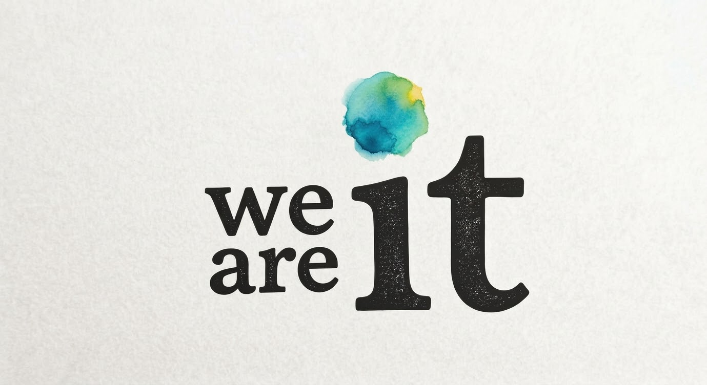

# We Are It — MVP Product & UX Specification

**Document status:** Working build specification, version 0.1, 16 October 2026.  
**Source:** Product-design conversation on 15–16 October 2026.  
**Purpose:** Preserve all significant proposed copy, UX behavior, examples, constraints, rationale, open questions, and deferred concepts discussed. Establish an intentionally tiny first release without losing the larger vision.

> **Latest decision governs launch scope.** Version 0.1 is the interactive first page, an account/save step after that page, a support page containing the donation form, and a help/contribution page. The personalized story, sharing, referral invitation flow, and growth flywheel were **explicitly removed from v0.1**, despite being developed earlier in the discussion. Keep them in the future-design record, not in the first-week deliverables.

## 1. Read this document first: decisions and status

**SHIP / agreed direction** means the latest concrete design choice for v0.1; **DESIGN CANDIDATE** means a specific suggestion not yet frozen; **DEFERRED** means keep the design but do not implement it for this launch; **VERIFY** means a promise, external fact, or integration must be checked before publication.

### 1.1 The minimum release

| Component | What ships | What does not ship |
|---|---|---|
| **Page 1: It can be better.** | Personal and societal pain exploration; multiple possible dreams for each pain; possible fixes grouped by chosen dream; visible progressive responses; repeatable selection; selection persistence | Generated shareable story; invitation prompts; referral engine; social network; generalized matching or coordination |
| **Account/save** | Minimal authentication after the first-page experience; save and later restore choices; privacy preferences | Elaborate profiles, identity checks for ordinary users, public activity by default |
| **Page 2: Support / donate** | Candid appeal headed **“It's free for you—and you're not the product.”**; a functioning donation form on the **same page**; optional company comparison; truthful project/funding information | A separate donation-page detour; obligatory support; fake live financial metrics |
| **Page 3: Help / contribute** | Voluntary ways to offer capabilities, skills, education/experience, time, feedback, and help building It | Automated labor matching, complex project coordination, volunteer onboarding bureaucracy |
| **Operational minimum** | Basic admin view of selections, aggregate idea/feature demand, donations, contribution offers; manual follow-up where appropriate | AI agent ecosystem; universal infrastructure; large graph backend; elaborate dashboard |

**Experience order:** brand → personal exploration → societal exploration → optional account/save → support/donation → help/contribute → (eventually) an ongoing product experience. Support and Help are invitations, not prerequisites to using It. A simple continue/skip route remains available.

### 1.2 Core hypothesis

A visitor can experience enough real value on the first page to believe It is worth existing and potentially supporting, **before** It builds its long-term coordination capabilities. The test is not whether people like the pitch; it is whether the interaction reveals a desirable future and a useful possible path, and whether some choose to support or help build the system.

The project can ship a working beginning **as the product**, with a candid request for the resources to grow it. This is intended as a roughly one-week build with coding agents (Codex/Claude/OpenCode) and the founder's existing ability; **one week is a target, not a guaranteed launch date**. Payment onboarding, compliance, copy review, and distribution may take longer than code.

## 2. Brand, proposition, and voice

### 2.1 Identity

Brand: **we are it** / **We Are It**. Product: **It**. User-supplied identity art shows black, heavily textured, slightly irregular serif letters, small stacked “we are” alongside a large “it”, an irregular blue-green-yellow watercolor mark, and a warm cream paper-like background. Keep this mark as a primary reference; do not silently redesign it. The combination feels human, imperfect, approachable, and non-corporate.

The words carry multiple meanings. At the beginning, “it” is whatever a person wants to improve; it is simultaneously the product's name. At the end, “we” is the people whose involvement can make better futures possible. It, too, can be improved by its users. **“It can be better” is the claim; the interaction is the demonstration.**

### 2.2 Core headlines / exact wording

- Brand: **we are it**.
- Hero: **It can be better.** (retain the period).
- Personal: **What could be better for you?**
- Societal: **What could be better for us?**
- Original future personal-story page: **Josh's better future.** *(deferred)*
- Original future invitation page: **We make it possible.** *(deferred as a dedicated page; remains important future copy)*
- Support heading: **It's free for you—and you're not the product.**
- Help heading: not finalized. Strong suggested candidate: **What could you help make possible?**
- Possible account prompt: **Save your possibilities.** (also considered: “Save your better future.”)

**Voice:** Minimal, plainspoken, candid, modest in the claim but ambitious in possibility; warm, occasionally self-deprecating; not a conventional VC-funded startup pitch. Avoid a large explanatory hero paragraph, overbearing conversion prompts, exaggerated certainty, or polished copy that obscures the one-person reality. The first page should look like the application, not an advertisement for a future application.

### 2.3 Working values exposed in the experience

- A person chooses what “better” means. Do not substitute the platform's preferred solution for their goal.
- A negative present condition can lead to **multiple legitimate better futures**. A job is not presumed to be the only possible solution to unemployment.
- Personal and societal lives already overlap; the product should reveal connections rather than manufacture ideological journeys.
- Explicit societal questions remain important: people care about injustices, institutions, future generations, science, ecology and strangers, not only the effects they feel personally.
- Not every desire comes from a pain. A later entrance must welcome positive dreams, goals, curiosity and creation without requiring a complaint first.
- Fixes are **possibilities** with honest status, uncertainty and requirements, not guaranteed outcomes.
- No ads, no sale of user data, and no optimizing to monopolize attention are intended product commitments; validate the public policy/legal wording before publishing.
- People should ultimately control their information, experience and the future of It; the mechanism for collective ownership/governance is a plan, not already completed.

## 3. Page 1 — The working product

### 3.1 Hero and immediate entrance

The simplest proposed first screen requires almost no product explanation:

> **It can be better.**  
> **What could be better for you?**  
> *Tap to explore*

Immediately show recognizable, tappable first-person pains. Exact examples raised:

> **Anxiety —** “I'm so worried about things.”  
> **Loneliness —** [copy to finalize; e.g., “I feel disconnected.”]  
> **Unemployment —** “I can't find work.”

Use an accessible, responsive, hand-authored list of collapsed pains. Avoid mandatory signup or a disconnected “learn more” click before any exploration. An optional one-line subheading (“For you. For the people you care about. For all of us.”) was considered but **is not required**; the latest preference is the sparse headline/question and immediate interaction. The hero can remain as the page unfolds; exact sticky/scroll treatment is open.

### 3.2 Pain → multiple dreams → possible fixes

The primary interaction is **simple, sequential and repeatable**:

1. Start with a list of **collapsed pains**. Tap a pain to expand it.
2. Expanded pain asks **“What does better look like?”** and **“Select everything that fits.”** Show multiple potential dreams / desired futures. Multiple selection is essential.
3. As dreams are selected, possible fixes **appear or begin populating**—including in a section farther down the page the person has not yet scrolled to. Under the selected pain, **group fixes beneath each selected dream**, never merge all fixes into an unlabeled pool. Let people explore or select multiple fixes per dream.
4. They can collapse that entire pain → dreams → fixes subtree and open another pain, without losing choices.
5. In a collapsed item with chosen dreams, the **selected dream language and visual take over as the dominant display**. The former pain becomes visibly smaller/subordinate; do **not** replace the content with “2 dreams” or a count-only summary. Shift the visual tone from subdued pain toward a hopeful future, ideally with a subtle morph rather than a jarring replacement.
6. Repeat across several pains. The same structure can operate under personal and societal sections. Allow revisiting/editing selections without restarting onboarding.

**Design nuance to resolve:** The earlier prototype suggested an explicit “Show fixes” expansion; the later, stronger proposal is that “Ideas that could help” begins filling immediately on the first dream selection. For v0.1, prioritize **instant feedback** with fixes available in the same flow. A separate “show more” control can progressively reveal detail without withholding the first ideas.

### 3.3 The crucial unemployment example — preserve this behavior

**Pain:** “Unemployment — I can't find work.”

**Question:** “What does better look like?” *Select everything that fits.*

**Dream options, verbatim:**

- “I have a job that pays enough.”
- “I have a career that I care about.”
- **“I can live well regardless of employment.”**

The third option is strategically essential: it allows a person to imagine a future other than the assumption that paid employment is the only successful outcome. The person might actually value stability, purpose, freedom, security, meaningful contribution, or combinations of those things.

**Illustrative ideas that could help** (appearing in the selected-dream groups):

- **Personal action:** “Find a local job fair” or, if an actual event is verified, **“Go to this [specific] local job fair.”** This could be a real task to save or pursue.
- **Potential It feature:** **Automated employment matching** (clearly labeled proposed/not yet built unless it exists).
- **Societal possibility:** **Universal basic income (UBI)**, linked naturally to “I can live well regardless of employment” and potentially later to “What could be better for us?”

**Do not claim every example helps every dream equally.** For example, a job fair should not be presented as the primary solution for choosing to live well without employment. Links must reflect the chosen dream and can branch to other dreams where genuinely relevant. A societal proposal must be explainable, debatable, and not falsely presented as immediately implementable.

**Why this matters:** A person who has never encountered UBI may discover it as one option within two or three ordinary interactions and become aware that other people are interested in the same idea. Hilary's reaction when shown the unemployment flow was: **“wow yeah holy shit we're not even three steps in and you're already talking about UBI.”** This is encouraging qualitative feedback, **not evidence of representative product-market fit**. The design should enable informed curiosity about tradeoffs and alternative policies, never quietly manufacture agreement.

### 3.4 Types of fixes and honest availability

| Type | Example | UX obligation |
|---|---|---|
| **Something I could do now** | A specific local job fair; reconnect with a friend; try a sleep routine | Actual, feasible task; verify live listings before using direct event links or claiming availability |
| **Existing resource** | Program, local group, opportunity, benefit, service | Match eligibility and location; source and date when consequential |
| **It capability to build** | Automated job matching; coordinating friends' available time | Label **Idea / proposed / in progress**, take feedback or interest; no fake-door implication that it already operates |
| **Cooperative initiative** | Shared shopping, neighbor childcare, community meal exchange | Say what participants/resources/permissions would be needed |
| **Societal change** | UBI; shorter workweek; accessible learning; alternative platform design | Present as a proposal or pathway with uncertainty and other approaches; not a short-term guarantee |

Do not force visible category badges if they make the experience feel technical. Distinguish status in short, legible everyday language. A person can select a future without endorsing every suggested fix.

### 3.5 Societal section on the same first page

> **What could be better for us?**

Use the same familiar mechanics: societal concerns or frustrations → multiple possible collective futures → proposed avenues of change. Keep this stage because it gathers **what people themselves diagnose about society**, plus goals that do not show up in personal discomfort. It also uncovers underlying explanations, disagreements, and possibilities missing from the personal-only map. Pains and societal paths may cross-link bidirectionally.

The working insight is that a *partial* societal roadmap may emerge from personal aspirations alone; this is a hypothesis to test, **not a reason to remove societal questions**. Include support for contradictory preferences, conflicting theories of causes, and alternative means to reach a shared goal. Do not count multiple disclosures of an idea as independent proof of its truth or effectiveness.

### 3.6 Start with pains; keep positive goals possible later

The pain-first strategy was inspired by **Amy Hoy**: common, recognizable difficulties are an easier entrance than asking strangers to articulate their life mission. It is a *starting tactic*, not a philosophical assertion that everything desirable must follow suffering.

Future complementary entrances discussed: “I want to write a novel,” “I want to restore a forest,” “I want to understand the universe,” “I want to build a school.” A design should preserve paths from these ambitions into goals, requirements, resources, action and cooperation. A minimal “Something else” input in v0.1 is optional if it does not imperil shipping.

### 3.7 User flow and state behavior (implementation contract)

**Initial:** first-page hero + collapsed personal pain choices. Societal section can be revealed by scrolling or a simple transition after personal exploration; avoid long, compulsory questionnaires.  
**Open pain:** show pain context, multiple dream cards, checkbox / multi-select control and prompt.  
**Choose dream(s):** immediately update visual state and preview of relevant ideas.  
**Ideas:** group by selected dream, with labels identifying real actions versus proposed capabilities/policies.  
**Choose idea(s):** optional; collect interest, not falsely assumed commitment.  
**Collapse:** selected dream(s) dominate; original pain becomes smaller; keep edits and per-dream selected fixes.  
**Next pain:** open another item without discarding previous work.  
**Societal:** repeat, supporting overlapping possibilities.  
**Finish first page:** an unobtrusive invitation to save progress with an account, plus clear onward links to Support or Help. No story generation or sharing required in v0.1.

Accessibility: full keyboard access, clearly associated form controls, screen-reader descriptions of disclosure state, motion-reduction support, sufficiently large tap targets, visible focus states, color-independent meaning. Mobile-first layout and quick response on ordinary devices are essential.

## 4. Examples discussed: five non-cherry-picked stress checks

A preliminary random-example gut check was performed in the conversation against a *recovered cold-start option subset*, **not verified against the original 31-item Tier 1 artifact**. No statistical conclusion is claimed. Its usefulness is that even unrelated everyday pains commonly admit individual, potential It, and societal paths within the first three stages.

| Starting pain | Possible better future | Personal change | It feature (candidate) | Societal possibility |
|---|---|---|---|---|
| **I spend too much time on my phone.** | “I control how I spend my attention.” | Turn off unnecessary notifications; phone-free times | Replace scrolling with appealing people and activities | Alternatives to engagement-maximizing systems; stronger user controls |
| **I don't sleep well.** | “I wake up feeling rested.” | Consistent schedule; investigate sleep disruption | Help coordinate responsibilities/schedules to protect sleep | Predictable work schedules; protections against excessive shifts |
| **I don't know what I want.** | “I can discover what makes my life meaningful.” | Try a new experience without long-term commitment | Connect to exploratory projects and unfamiliar roles | More accessible lifelong learning and paid exploration opportunities |
| **I never have enough time.** | “I have enough time for the people and things that matter.” | Reduce or delegate repeat obligations | Coordinate chores, caregiving and resource exchanges | Shorter workweeks, childcare and paid family leave |
| **I eat worse than I'd like.** | “Eating healthy, enjoyable food is easy and affordable.” | Find enjoyable, affordable easy meals | Neighbor grocery purchasing, cooking or meal exchanges | Food cooperatives; affordable nutritious food access |

These are **candidate connections**, not endorsements, validated interventions or promises that the full It features exist. Some examples require follow-up to identify the actual cause; e.g. poor sleep need not be a scheduling issue.

## 5. What the personal-to-societal relationship means for the design

People share some problems, but **different problems may share a possible solution**. Unemployed people, caregivers, entrepreneurs and overworked employees could all be interested in more financial freedom, without necessarily favoring the same policy. Conversely two people with an identical complaint may want fundamentally different futures.

The immediate UX does not need to impose a new political identity: it can let someone discover that a potential path has broader social implications. Across participants, the product may later identify overlap among goals, information, resources, constraints and capabilities. The product should not simply group users into “people with the same grievance.”

A motivating example discussed: **100,000 people × $10 per month × 12 = $12 million per year**, before expenses, if they all choose to contribute consistently. Such a group might have a small city's worth of skills, relationships and capacity to form projects or nonprofit institutions. This is illustrative collective potential, **not a forecast**, not a promise of donor conversion, and not evidence that resources are immediately deployable.

## 6. Accounts and persistence — immediately after Page 1

**Ship:** A minimal way to save the interests, dreams and paths the person has explored after they experience value. Possible labels: **“Save your possibilities.”** / **“Save your better future.”** An account also enables recurring support and contributions, and eventually an ongoing history; however, **ordinary donors do not generally need KYC** just to give, and payments need not technically require a full It account. The payment provider may require **verification of the recipient / organization** and other compliance; confirm with the actual processor.

Do not require an account before the first interaction. Respect private choices. Don't make someone's pains publicly visible or turn a private selection into a shareable artifact by default. Let them amend, remove and (when implemented) export choices. If someone declines signup, provide a way to continue using the free experience, with temporary local/session state where feasible.

**Minimum fields:** account ID, authentication credential or provider reference, timestamps, optional contact consent; per-pain dream selections and optional per-dream idea interest; content version; optional consent to use anonymized aggregated feedback. The saved state will support future stories and coordination without committing to their first-release UI.

## 7. Page 2 — Support and donation on the same page

### 7.1 Role and title

**“It's free for you—and you're not the product.”**

This is the donation page itself, *not* an “About” page that leads to a separate donation page. The Guardian's reader-support appeal was the reference, but the intended tone is **less intense, more approachable, more candid**. The page makes clear why this project's funding model differs from advertising-funded and conventional venture-backed platforms, why building it will cost time/money/help, and what the visitor can do now—without obligation or pressure.

### 7.2 Founder-written copy — exact working source (preserve)

> It won't show you ads, sell your data, or monopolize your attention.
>
> People should have better ways to live better.
>
> Right now, the "we" in "We are It" is just me—and hopefully you, too. It's going to take time, money, and lots of help.
>
> It already belongs to you, at least in some sense—you can check our licensing. But the plan is to build something that you truly own and whose future you can decide, starting now. As you can imagine, that's going to involve a lot of work, which is why It need whatever help it can get.
>
> If that's the future you want, you can help support it. If you can't, you're just as welcome here (I honestly couldn't right now myself). And there's plenty of other ways you can help, not least of which is helping yourself. That's kind of the whole point of it.

*Editorial note:* “It need” is an uncorrected typo in the source; “It needs” in the proposed display edit below. Preserve the original text for provenance. The founder explicitly wants openness about his financial situation but does not want the page to become a personal bailout appeal.

### 7.3 Lightly edited production candidate — same voice, verify commitments

> **It's free for you—and you're not the product.**
>
> It won't show you ads, sell your data, or monopolize your attention.
>
> People should have better ways to live better.
>
> Right now, the “we” in “We Are It” is just me—and hopefully you, too. It's going to take time, money, and lots of help.
>
> It already belongs to you, at least in some sense—you can check our licensing. But the plan is to build something you truly own, whose future you can help decide, starting now. As you can imagine, that's going to take a lot of work, which is why It needs whatever help it can get.
>
> If that's the future you want, you can help support it. If you can't, you're just as welcome here (I honestly couldn't right now myself). And there are plenty of other ways you can help, not least of which is helping yourself.
>
> That's kind of the whole point of It.

This is **a candidate**, not approval to overstate current licensing, governance, ownership, privacy or funding terms. Add links to actual license, privacy policy, future governance explanation and published budget. Consider reducing language that could be read as a binding guarantee until commitments are implemented and reviewable.

### 7.4 Donation form directly under the letter

Functional donation form on same page. Consider **monthly / one-time** toggle; quick amounts **$5, $10, $25, $50** plus custom amount; clear amount and frequency; simple checkout; donor email/receipt; easy cancellation for recurring support. A simple, tasteful **“Can't contribute? That's okay. It is still yours to use.”** or equivalent should be visible. Avoid dark patterns or recurring donations by surprise.

Funds may cover hosting, tools, payment costs, content verification, implementation and **compensation for the founder's time and essential living expenses**, stated plainly if applicable. Show operating expenses and realistic runway when possible. Donation tax-deductibility must not be implied unless the organization legally qualifies.

**Previous additional draft sentiment (optional, not frozen):** “We don't want your attention for sale. We want to help you do something worthwhile with it.”; “We're not building It to show you ads, sell your data, or turn your attention into someone else's profit.”; “If you can't, you're just as welcome here.”

### 7.5 The comparison sidebar — size of incumbents and size of It

The sidebar communicates **“what we're up against / what we're working with.”** It need not demonize the companies or obscure differences; the disparity itself is striking. Display big-technology-company **2025 total revenue and employees**, then actual It figures. User preference ultimately shifted toward *revenue and employees* as the simplest, readable comparison (rather than budgets). Suggested layout on wide screens: small, secondary column alongside letter and donation form; on phones place as a compact collapsible section below the primary appeal.

| Organization | 2025 total company revenue | Approx. year-end employees | Source / caveat |
|---|---:|---:|---|
| Amazon | **$716.9 billion** | **1,576,000** | Amazon 2025 10-K; includes retail, AWS, advertising and logistics |
| Alphabet / Google | **$402.8 billion** | **190,820** | Alphabet 2025 10-K; includes all business lines |
| Meta | **~$201.0 billion** | **~78,865** | Meta 2025 10-K; verify the latest filing numbers in production |
| **We Are It** | **Live actual funding figure** | **1 founder** initially | Label monthly receipts, annualized recurring donations, and operating budget separately; don't invent ARR |

The corporate financial figures are historical annual **revenue**, not budgets, profits, costs of running software or ad-only income. Live **annualized recurring donations** are not the same as *realized annual revenue*. Clearly distinguish them, including timeframe, last update and source. Show actual team size; volunteer/helper headcount must not be labeled employees. Another optional metric is **supporters / collaborators**.

**Revenue sources and follow-up checks:** Amazon 2025 SEC 10-K: https://www.sec.gov/Archives/edgar/data/1018724/000101872426000004/amzn-20251231.htm; Alphabet 2025 10-K: https://www.sec.gov/Archives/edgar/data/1652044/000165204426000018/goog-20251231.htm; Meta filing index: https://www.sec.gov/Archives/edgar/data/1326801/000162828026003942/0001628280-26-003942-index.htm.

### 7.6 Optional: ad-derived value per person (not the primary comparison)

A secondary note could explain what advertising platforms obtain per active user, but per-user figures differ greatly by platform, geography, daily/monthly denominator, and whether they measure actual ads or total revenue. Earlier illustrative figures discussed included Meta **$57.03 worldwide daily-user ARPU**, and region-specific figures for Snap, Reddit and Pinterest; **do not publish as a single comparable ranked table without independently validating definitions and periods**.

The user supplied Proton's analysis: https://proton.me/blog/what-is-your-data-worth-to-google. Proton reported modeled **$1,605 mean** and **$760 median annual advertiser value** for U.S. demographic/search profiles, with a range of roughly **$31–$17,929**. **This models advertiser demand based on 2025 auction benchmarks; it is not Google's measured actual revenue from any individual**. It is useful to illustrate advertising incentives, but it is a very different unit of analysis from corporate revenue or audited per-user revenue. Keep it optional and accurately labeled.

### 7.7 Optional: simple collective support arithmetic

An interactive sidebar tool can show **potential annual resources = contributors × average monthly contribution × 12**. Example ranges discussed: 1,000–100,000 contributors and $1–$25/month, explicitly **scenario modeling, not a financial forecast**. At 100,000 × $10/month, annual gross contributions would be $12,000,000. Show actual costs and net funds separately. In v0.1 this widget is optional; it must not delay donations from working.

### 7.8 Founder transparency without overexposure

There is a genuine balancing problem: an overly polished product may prompt “what's the catch?” whereas a one-person project may seem unlikely to survive. Answer with **capable product, honest organization**: clearly identify what works, what isn't built, the actual resources, the founder's involvement, money needed and milestones. Do not pretend the project is venture-backed; the working intent is no VC, no ads, no data sales, and eventually genuine user governance. Do not imply that a one-person, cash-constrained project is already a fully formed user-owned institution.

Founder has stated serious near-term financial constraints, including the possibility of inability to cover a credit-card payment in about six weeks. This is **internal background**, not automatically public copy. Founder support is legitimate if disclosed; avoid guilt-based fundraising or forcing visitors to feel responsible for rescuing one individual.

Optional disclosure / navigation copy (near support section, not dominant):

> **Want to know more about It or me?**  
> “I don't love talking about myself on the internet, but I understand why you need to know who I am.”

An expandable section or link can lead to **Why I'm building It**, **Who I am**, and **How It works and who controls it** (history/track record; licensing; ownership; governance intentions; finances). Also make this discoverable outside the donation page. Trust should be possible without reading a biography.

### 7.9 Ownership, governance and licensing language

The line **“It already belongs to you, at least in some sense—you can check our licensing”** should link to the exact license and explain **what it actually grants today**. The plan for people truly to own the institution and help decide its future is an intended future governance structure, not a completed present guarantee. Long-term design includes the ability for people to retain their history, relationships and commitments, and ideally switch software/providers rather than be captive to the operator. That architecture need not block the one-week MVP; avoid wording that promises it is already implemented.

## 8. Page 3 — Help / contribute

### 8.1 Purpose and leading question

The founder has not settled on this page's copy. A strong candidate from the discussion is:

> **What could you help make possible?**

This page can ask what the visitor **can do**: employment or profession, education, skills, experiences, capabilities, available time, interests, resources, connections, and the forms of help they would consider. Avoid reducing people to job titles, credentials, or capacity to work for free. Skills may be used **for their own future** or, with permission, to help others and to build It. Some people can help by testing, proposing ideas, providing content, correcting assumptions, making introductions, doing design/coding, or supporting another participant; others can simply use It.

### 8.2 Minimum controls

- Offer to help with It: interests/capabilities (free text and lightweight tags); possible availability and preferred contact method; explicit permission to contact.
- Optional specific asks related to current build needs: test an idea, suggest a better fix, verify a local resource, design UI, implement feature, improve accessibility, review content, help with organizational setup.
- Simple submission and confirmation. Clarify when an offer has **not yet been matched** to a real task.
- Founder/admin receives an orderly record and can follow up manually.
- Clear skip / “not now”. **Helping yourself is part of the point**, not a deficient contribution.

### 8.3 Participatory roadmap: optional simple cards

The product itself is the first shared project. A simple idea card could say:

> **An idea we're exploring**  
> “Help people find time to spend together.”  
> Imagine an easier way to discover overlapping free time, make plans and organize activities with people you care about.  
> **This isn't built yet. Would you find it useful?**  
> Yes / Maybe, tell me more / No, not for me.  
> **Would you like to help make it happen?** Test, suggest ideas, introduce someone, or help build it.

In v0.1 this is a **candidate minimal feedback card**, not a commitment to implement a separate roadmap application. Where simple enough, record interest in ideas on Page 1 and show build needs on Page 3. Do not invent project status, timelines, or contributors. The owner can manually connect demand to possible help.

## 9. The self-recursive product thesis

The earliest version of It can be used to help **make It better**. Someone expresses a desired future; a candidate It capability appears; the person identifies demand; another person can offer a relevant capability; the team can attempt to build it; actual outcomes can be shown back to the community. Initially the coordination is partly manual. This makes the product development roadmap an authentic early use case rather than fabricated “collective intelligence” infrastructure.

**Do not let this become an excuse to build the generalized It system for v0.1.** The initial project may have three pages and a small admin workflow. The larger process evolves only as real usefulness, demand, capabilities and contributions become visible.

Longer-term It may keep changing accounts of people/groups' goals, information, skills, resources, permissions, constraints, relationships and commitments, then help find next actions, complementary contributions and requirements. This is a north star, not v0.1 scope.

## 10. What was explicitly cut or deferred

| Feature | Earlier vision / exact copy | Status |
|---|---|---|
| **Personal story** | **“Your story”**; **“Josh's better future.”**; generated shareable account of selected dreams and potential paths | **DEFERRED**. Preserve data for possible future generation; no initial story UI. |
| **Invitation page** | **“We make it possible.”** after people see their desired future | **DEFERRED** as a page and interaction. Brand line still useful. |
| **Sharing** | Copy/share a selected better future or path; invite friends to explore | **DEFERRED**. Not an MVP requirement. |
| **Referral mechanics** | Ask “Who are two people you care most about / trust / admire?” or “Who are two people you'd trust to explore what's possible for themselves?” | **DEFERRED**. Invitation is to **It generally**, motivated by the future the visitor has just seen, not a demand to endorse that particular future. |
| **Growth mathematics** | Two invitations per participant; candid demonstration of what participation could mean for collective capacity | **DEFERRED**. Mathematical model preserved below; do not force in first donation flow. |
| **Ongoing personalized product** | List of doable actions now, interests/goals/beliefs questions, potential work, recommendations, future capabilities and feedback | Later expansion; v0.1 can stop after pages and save without elaborate dashboard. |
| **Coordinating societal coalitions/projects** | Linking overlapping goals, diverse motivations and complementary resources; possible nonprofits and coordinated initiatives | North-star capability; no automated coalition formation in v0.1. |
| **Native positive-dream entrance** | “I want to write a novel” and other dreams not caused by pain | Preserve for next product iteration; avoid conceptually defining It as pain-only. |

### 10.1 Why the deferred invitation mattered

The visitor's motivation begins with the future they just imagined. In the later invitation flow, they can understand why **more people in It** could make that future more reachable, even if their invitees pursue other goals. That's not a generic growth hack: it is a possible first practical step toward the visitor's chosen future. The proposed progression was:

> **It can be better.** → **We make it possible.** → **We Are It.**

The larger question posed: “Who are two people you'd most like to see have this opportunity?” The idea was **not** to recruit them into the inviter's policy position or individual project. Sharing and invitations can be added later without requiring this functionality in launch v0.1.

### 10.2 Honest invitation math (future only)

If every participant brings **two genuinely new participants** who themselves repeat the process, cumulative size starting from one is \(2^{r+1}-1\) after \(r\) rounds: 4 rounds = 31; 8 = 511; 12 = 8,191; 16 = 131,071. If each of two invitations produces a continuing participant independently with average probability \(p\), expected reproduction is \(2p\); the simple branching model is supercritical only if \(p>0.5\). Real networks exhibit overlap, saturation, drop-off, heterogeneous behavior, delays and non-independence. **Never promise exponential growth or “we can literally do anything” as a statistical conclusion.** Teach the math honestly if added later.

## 11. Content inventory and seed data

An earlier research workflow had a **Tier 1** list described in the conversation as **15 personal and 16 societal pains**, with personal groupings **Body, Head, Money, Time, People, Doing** and societal groupings **Power, Economy, Each Other, Dignity, Information, Change**. The exact 31-item document called **“It MVP — Tier 1 Pains and Dreams”** was **not actually recovered** in this conversation. It must be obtained and reviewed before treating it as a canonical content file. The original large research corpus of many more pains is **not identical** to the curated Tier 1 release list.

**Examples explicitly raised here:** anxiety, loneliness, unemployment, paying bills, retirement insecurity, housing costs, lack of enjoyment, work overload, family conflict, poor sleep, isolation, worrying about climate change, lack of purpose, too much phone time, uncertainty about personal goals, lack of time, unhealthy eating; additional societal examples included corruption and distrusting news. Do not silently pretend these constitute the exact Tier 1 collection.

**Content rules:** first-person, everyday wording; avoid jargon and diagnostic assumptions; one recognizable issue per selection; multiple legitimate desired futures; ideas tied to actual desired future; source/accuracy status for practical resources and political proposals; visual treatment sensitive to distress; support missing issues and content iteration.

## 12. Suggested minimal data entities and events

**Pain** (`id`, `scope`, `group`, `shortLabel`, `firstPersonCopy`, `contentVersion`, `order`, `active`); **Dream** (`id`, `painId`, `firstPersonCopy`, `illustrationRef?`, `order`); **Idea/Fix** (`id`, `dreamIds[]`, `copy`, `type`, `availabilityStatus`, `sourceOrEvidence?`, `locationRequired?`, `publicPolicy?`); **Selections** (`accountId?`, `painId`, `dreamIds[]`, `selectedIdeaIdsByDream`, timestamps, contentVersion); **Idea feedback** (`ideaId`, `interest`, account/session ID, consent); **Support** (`paymentProviderRef`, recurring vs one-time, receipts/aggregate stats, privacy controls); **Contribution offer** (`accountId`, offer text/tags, availability, contact consent, followUpStatus`).

Prefer versioned, explicit selection events over an untraceable answer blob, but don't overbuild infrastructure. Keep sensitive personal selections private by default, with narrow admin access. Publishing aggregate demand needs clear aggregation definitions and enough privacy protection to prevent exposure of a small group. Store only what's needed for real product function. The future social graph and coalition engine should not be baked into a first-week schema.

## 13. Success criteria, instrumentation and trust

### 13.1 What would make Page 1 genuinely useful?

At least some users should discover one plausible future they hadn't articulated and a useful idea or next action that corresponds to it, **before** being asked for an account, donation, or volunteer labor. The first selected dream should visibly affect the page. Users should be able to say what new possibility they saw. All existing versus proposed capabilities must be correctly labeled.

### 13.2 Launch metrics (small and honest)

- Page view → first pain opened → first dream selected → first idea encountered.
- Number of meaningful dreams selected, idea-interest events, completion of personal and societal stages, drop-offs.
- Voluntary saved accounts after exploration; return visits and selection edits.
- Support page visits, actual donation conversions, recurring-support cancellations; verified monthly receipts and payment costs.
- Help page visits, consenting contribution offers, follow-ups and actual contributions.
- Qualitative: What was useful? Did anything surprise you? Did they understand the difference between live opportunities and ideas? Did the page make them feel pressured?

No fabricated user counts, fake social proof, unsupported conversion forecasts, or live revenue labels without actual data. Protect against analytics that would inadvertently undermine the promise not to monetize attention or exploit private information.

### 13.3 Trust and disclosure checklist

- Link a readable privacy policy, actual license and plain-language rights summary.
- Separate already-owned rights from future governance and ownership intentions.
- Clear donation legal/receipt/tax status; no “tax deductible” claim without eligibility.
- Payment processor verification of the recipient/organization (KYC/merchant onboarding) versus ordinary user accounts.
- Actual year, source and denominator for company metrics; label hypothetical donation scenarios.
- Founder identity optional but accessible; founder financial urgency conveyed honestly without emotional coercion.
- Ability to use the product without donating, offering labor, inviting friends, or endorsing specific societal policies.

## 14. One-week implementation plan (target, not guarantee)

| Day | Workstream | Minimum acceptance |
|---|---|---|
| **1** | Brand/hero, data fixtures, collapsed pain cards | Mobile usable; initial copy exact; no signup gate |
| **2** | Multi-dream selection, idea mapping, selected-dream takeover | Multiple dreams; fixes grouped per dream; instant lower-page feedback; collapse restores state |
| **3** | Personal + societal sections, content quality, privacy defaults | Both routes work; clear real/planned/societal idea status; no forced worldview |
| **4** | Accounts, save/restore, basic records/analytics | Visitor experiences Page 1 first; persistence works; edits retained |
| **5** | Support page + working checkout; factual sidebar optional | Appeal flows into donation form; receipts/processor tested; skip works |
| **6** | Help form, admin intake, minimal feature interest signals | Submitted consented offers can be seen and handled; no fake automated coordination |
| **7** | Mobile/accessibility/security/content QA, legal copy check, launch preparation | End-to-end smoke tests; essential policies; measured events; public access |

Start processor/organization onboarding in parallel, because it may take longer than coding. Keep the app as one straightforward deployable application and initially hand-author content. If funding integration blocks launch, do not misrepresent the checkout as functioning; choose a legitimate ready-to-use hosted option or delay the donation action only.

### 14.1 Concrete acceptance tests

1. Opening the site reveals **“It can be better.”** and clickable pains without requiring a login.
2. Unemployment exposes the three quoted dreams including **“I can live well regardless of employment.”**
3. Choosing any subset of dreams shows relevant ideas under each selected dream, without mixing their labels.
4. A selected dream begins changing the lower “Ideas that could help” content immediately.
5. Collapsing a pain gives visual dominance to selected dream text/illustration; pain is smaller, not replaced by a count.
6. Reopening, changing selections and moving to another pain retain correct state.
7. Societal exploration repeats the basic mechanics and permits different/contested outcomes.
8. Real resources show grounded availability; unbuilt It features show a proposed status; policy ideas are not “click to activate.”
9. Optional account creation **after** Page 1 saves and reloads selected state.
10. Donation form works and states recurring/one-time clearly; the page is usable without donating.
11. Live It funding, if shown, comes from actual transactions; company figures are sourced and dated.
12. Help page accepts voluntary skills/experience/interest and contact permission, then acknowledges receipt.
13. Nobody is forced to share, invite, join a coalition, or generate a personal story.
14. Readable on phones; touch/keyboard/screen-reader support; privacy and license links function.
15. Admin can inspect content interest, payment state and consented help offers without building automated matchmaking.

## 15. Risks, tradeoffs and strategic claims

**Usefulness vs questionnaire:** If visitors merely make selections and leave without discovering a meaningful idea, it isn't the promise fulfilled. Seed enough real, thoughtful possibilities to surprise without pretending certainty.  
**One person vs polished product:** Make the product capable and the organization honest. Show what's real and missing.  
**Funding urgency:** Near-term need is real; the site shouldn't obligate visitors to rescue the founder. Transparent founder compensation can be appropriate.  
**Distribution:** Three compelling pages do not guarantee enough visitors or donors; launch needs a separate distribution plan and actual tests.  
**Political openness:** Users can discover UBI, shorter workweeks, institutional reforms and conflicting approaches. The system informs and enables choices, not quietly steers supporters toward a single policy.  
**Complexity:** Resist adding AI agents, public social graphs, sophisticated dynamic recommendations, generalized governance, invitations or elaborate front-end animation if they delay a working minimum.  
**Trust/legal:** “You're not the product,” licensing, ownership, data policy and payment practices create obligations that must be implemented, accurately worded and checkable.

## 16. Copy library and earlier alternatives (historical, not all to ship)

**Opening chain**

> “It can be better.”  
> “What could be better for you?”  
> “What does better look like?”  
> “Select everything that fits”  
> “Ideas that could help:”  
> “What could be better for us?”

**First-person examples**

> “Anxiety — I'm so worried about things.”  
> “Loneliness — ...”  
> “Unemployment — I can't find work.”  
> “I have a job that pays enough.”  
> “I have a career that I care about.”  
> “I can live well regardless of employment.”

**Earlier future-flow sections (explicitly not v0.1)**

> “Your story” — “Josh's better future.”  
> “Invite” — “We make it possible.”  
> “Who are two people you care most about in the world? Trust? Admire?”  
> “Who are two people you'd want to explore this future with?”  
> “Who are two people you'd trust to explore what's possible for themselves?”  
> “Imagine what we could do if everyone could find their own path to something better—and we could help each other get there.”  
> “It can be better.” → “We make it possible.” → “We are It.”

**Support copy candidates raised**

> “It's free for you (but it costs money).” *(superseded)*  
> **“It's free for you—and you're not the product.”** *(current)*  
> “People should have better ways to live better.”  
> “Right now, the ‘we’ in ‘We Are It’ is just me—and hopefully you, too.”  
> “If you can't, you're just as welcome here.”  
> “There's plenty of other ways you can help, not least of which is helping yourself. That's kind of the whole point of it.”  
> “Want to know more about It or me?”  
> “I don't love talking about myself on the internet, but I understand why you need to know who I am.”

**Help/participation candidates**

> “What could you help make possible?”  
> “Help make It possible.”  
> “This isn't built yet. Would you find it useful?”  
> “Would you like to help make it happen?”

**Possible future product interface**

> “Your It” / things you could do now; more questions about interests, goals and beliefs; speculative future capabilities as sketches/placeholders with feedback; open project and build requests. *Future evolution, not required for this v0.1 launch.*

## 17. Unresolved decisions before public launch

1. **Exact Tier 1 corpus:** locate the real list (31 items as reported), original wording, and dream/fix mappings; identify validated versus invented content.
2. **First-page framing:** Is societal below personal on the same continuous page? Is there a subtle stage transition? Does a selection immediately populate fixes, with optional “show more”?
3. **Illustrations / animation:** what lightweight visual treatment conveys the dream taking over without expensive production or excessive motion?
4. **Accounts:** minimum signup method, unregistered session persistence, what is retained and for how long, and explicit consent.
5. **Legally accurate license/ownership language:** which rights users hold now, and what remains a governance aspiration?
6. **Donation processor:** individual/organizational merchant verification, receipts, fees, recurring cancellation and tax-language review.
7. **Sidebar numbers:** do we show the comparison in the first release or shortly after? If shown, use real, sourced, dated revenue/headcounts and transparent current It metrics; no pretend ARR.
8. **Optional founder background:** a short expandable statement and credible links without turning the support page into a biography or emergency appeal.
9. **Help form:** minimum useful skill/time/interest fields and the manual follow-up workflow.
10. **Initial content quality:** enough genuinely usable immediate actions to demonstrate value; avoid unverified local events and fictional live services.
11. **Distribution:** who sees the launch, how, what is measured, and what happens if support conversions are low.
12. **Launch boundary:** no sneaking story/invites/sharing back into the week-one requirements.

## 18. Why this form emerged: observed conversation signals

Hilary initially liked **“It can be better”** because it made sense and people could immediately see how helpful It might be. She described the visitor as able to **“see the path.”** Later, after the unemployment example revealed UBI in fewer than three steps, she reacted with surprise at how rapidly a personal concern could expose a broader social possibility. These are useful design observations and encouraging personal reactions—not a substitute for broader trials.

The founder reported feeling **much more confident** about the build after exploring this interaction and progressively cutting complexity. A major insight was that a *polished minimum* needn't be a pretend demonstration: the first page can show paths, the support page can request resources honestly, and the help page can enable real participation in building the next iteration. Sharing, story generation and invitation would amplify the idea, but are *not necessary to test whether enough people want It to exist*.

**Final product test:** Can a visitor, in minutes, identify something that matters to them, see a plausible new future and a useful next step, and then independently judge whether It deserves to exist tomorrow?

---

**Source and provenance note.** This is a synthesis of the conversation, with founder-supplied wording preserved where labeled. Corporate revenue/employment figures were cross-checked against 2025 SEC reports; Proton's advertising values are model-based and correctly qualified. Conceptual illustrations, copy candidates and the week-one plan remain proposed rather than accomplished. The founding vision and deferred concepts are preserved here deliberately without expanding launch scope.
