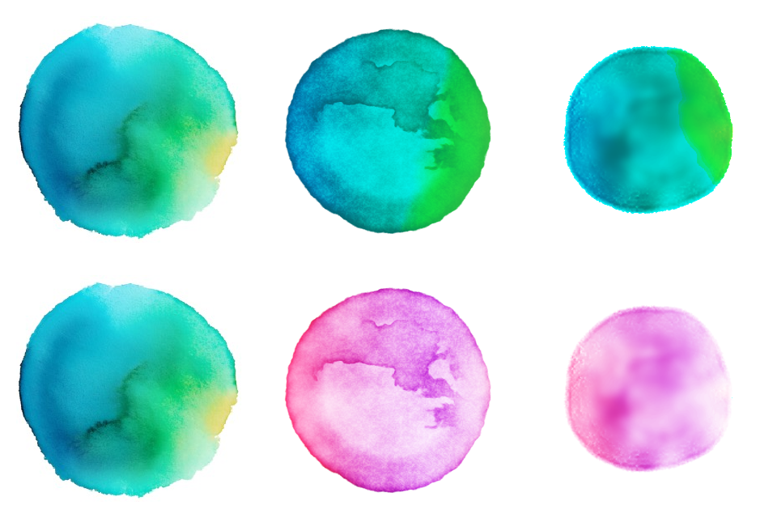

# Fidelity proof results — watercolor dot (007)

Status: **verdict B recorded (2026-10-17); on-device measurements still to do** (T027).

How to run the proof: `specs/007-watercolor-dot/quickstart.md` §3. Open `/lab/watercolor` in a development build, on screen (not in a hidden window or background tab), on an iPhone 12 and on a laptop in Chrome and Safari.

## What is being compared

Columns: the painted orb (reference, never re-colored); **B**, the look-alike shader drawn live from noise; **E**, the dot painted ahead of time by `tools/watercolor-sim` and colored live with pigment optics. Rows: It's palette (`it-orb`) and the proof palette (`rose-violet`). Rendered with the same shaders as the app, through Skia's CanvasKit (`tools/watercolor-sim/compare.ts`).

Notes from building it (2026-10-17, not a verdict):

- **E** shows the marks that come from physics: an organic edge that spread and pinned, a tide-line rim, pigment pooling, and the rose palette taking on the same structure. It is softer and blurrier than the painting, and the orb palette reads more cyan than the painted orb.
- **B** reads closer to the painting at a glance (crisp backrun bloom, grain), but its marks are imitated, so every B dot shares the same kind of structure. The orb palette's green side is harsher than the painting's.
- Neither has the painting's yellow patch yet; the third pigment's placement needs tuning in whichever approach wins.
- Swapping palettes works for both by changing data only (FR-014).

## Measurements

| Approach | Device | Scenario | p99 frame (ms) | Max frame (ms) | Meets 60 fps? |
|---|---|---|---|---|---|
| B | iPhone 12 | 1 large | — | — | — |
| B | iPhone 12 | 30 small | — | — | — |
| E | iPhone 12 | 1 large | — | — | — |
| E | iPhone 12 | 30 small | — | — | — |
| B | Laptop, Chrome | 1 large | — | — | — |
| B | Laptop, Chrome | 30 small | — | — | — |
| E | Laptop, Chrome | 1 large | — | — | — |
| E | Laptop, Chrome | 30 small | — | — | — |
| B / E | Laptop, Safari | (as above) | — | — | — |

Fill from the lab's "Results" JSON. A run made while the window is hidden is invalid: browsers throttle hidden pages to about one frame a second (seen 2026-10-17 in a hidden pane, where even an empty page managed 3 frames in 2 s).

## Web download

| Item | Uncompressed | Compressed (gzip) |
|---|---|---|
| Skia runtime, `canvaskit.wasm` 0.41.0 | 7.9 MB | 3.2 MB |
| Painted dot atlas `orb-01` (Option E only) | 370 KB | 366 KB (PNG is already compressed) |
| **Total for E on web** | | **≈ 3.6 MB — over the 1 MB budget** |
| **Total for B on web** | | **≈ 3.2 MB — over the 1 MB budget** |

After the verdict the founder asked for B on web too. B's shader is now translated to GLSL and drawn with the browser's WebGL, so web needs neither CanvasKit nor the atlas:

| Item | Size |
|---|---|
| **B on web via WebGL** (shader source and the small renderer in the app bundle) | a few KB — within the 1 MB budget |

Skia's web runtime is loaded only in the dev lab.

## iOS build (2026-10-17)

The iOS dev build did not link: Expo's dev launcher references `RCTPackagerConnection`, which the React Native core in the build didn't provide (`Undefined symbols … _OBJC_CLASS_$_RCTPackagerConnection`). Skia was not involved, and updating Expo to 57.0.30 did not fix it.

Cause: `Pods/React-Core-prebuilt` held the Release build of React Native's prebuilt core, which leaves out the dev-only classes, and had no `.last_build_configuration` marker. React Native's `replace-rncore-version.js` assumes Debug when the marker is missing, so it never swapped in the Debug core. Fix (local; `ios/` is generated and not committed): write `Release` to `apps/app/ios/Pods/React-Core-prebuilt/.last_build_configuration` and build again; the script then swaps in Debug and the build links. If it recurs after `pod install` or prebuild, repeat that step.

Running it on the simulator with Xcode 27 (no Simulator.app; DeviceHub instead): taps and swipes from the simulator panel don't reach the simulator, so the dev launcher can't be used. Everything can be opened by deep link instead:

- Approve the app's URL schemes once so iOS doesn't ask "Open in It?": add `com.apple.CoreSimulator.CoreSimulatorBridge-->weareit` (and `-->exp+we-are-it`) = `com.joshsmith.we-are-it` to the device's `data/Library/Preferences/com.apple.launchservices.schemeapproval.plist` while it is shut down.
- Skip the dev menu intro: `xcrun simctl spawn <device> defaults write com.joshsmith.we-are-it EXDevMenuIsOnboardingFinished -bool YES`.
- Load the bundle: `xcrun simctl openurl <device> "weareit://expo-development-client/?url=http%3A%2F%2Flocalhost%3A8081"`, then open a page, for example `weareit:///lab/loader` (the gathering loader alone, development only).

The gathering loader runs on iPhone 15 Pro (simulator) through Skia. iPhone frame measurements still wait on a real device.

## iOS binary growth

To measure: compare the release `.ipa` size before and after Skia (T047).

## Findings during the build

- **One canvas per screen of dots, not one per dot.** Thirty dots as thirty separate canvases exhausted the browser's GPU contexts and the dots failed to draw. The renderer now draws many dots in one canvas (`SkiaDotField`). Placements that show several dots, and any later "gathering" animation, should share one canvas. Apply the same rule on iOS.
- **Option E painting is quick and exact.** `orb-01` (256 px, 20 frames, 3 pigments, seed 1729) paints in about 4 s on a laptop and repaints byte-for-byte from its manifest.

## Verdict

- Choice: **B — the look-alike shader is "the same family" as the painted orb.**
- Date: 2026-10-17
- Notes: chosen by the founder in the lab on web (laptop, Chrome in the Claude app's browser pane), still view in It's palette. Smoothness on iPhone 12 is still to be measured once the iOS build links; on web, v0.1 uses the animated painted orb regardless (download budget). Option E's simulation tool stays in the repo for later work (painted textures, scenes).

## People check (SC-008, before shipping)

3–5 people, anonymous. Questions: what does it feel like; what is happening; does waiting feel calmer or slower?

| # | Feels like | What is happening | Calmer or slower |
|---|---|---|---|
| 1 | | | |

## Living loader comparison (T053, 2026-10-17)

Lab section "Living loader — compare" at `/lab/watercolor`.

- **1 — Shader B, living**: crisp first-bloom edge; pigments flow and marble; a drop of new color lands every 2.6 s and blooms in, pushing paint to a darker ring and merging over a few seconds; the palette drifts It orb → sunrise → dusk over about 14 s each; "Content arrived" dries it (rim, bloom line, granulation) over 1.4 s, then it fades. Runs on web (WebGL) and iOS (Skia).
- **2 — Live paint simulation** (prototype, web only): a 192² GPU simulation of wet paint. Paint is applied and spreads, drops push into the wash, a slow current marbles the pigment, and "Content arrived" dries it. Behaves like paint but is not yet tuned: ragged edge with holes, colors lean cyan and pale, and it dries faint. More tuning would be needed if chosen.
- Download on web: shader code only for both (a few KB).

Founder's choice: —

## Loader direction (2026-10-17)

After the verdict, the loader went through several versions: a subtle breath, a visible breath with turning, a bloom loop, a deeper dissolve with swirling pigment, a wet-to-dry loop moving through It orb, sunrise and dusk palettes, and finally a "living" dot B (drops of new color blooming into a wet wash) beside a live GPU paint simulation. None matched what the founder had in mind. The loader is back to the original B bloom loop (crisp bloom, rest, soft fade, repeat) on web and iOS; the experiments are kept on branch `explore/living-loader`, and alternative ideas are being storyboarded (T056).

## Gathering loader chosen (2026-10-17)

From four storyboarded ideas the founder chose gathering, refined it in the lab (varied drop sizes, slow arrivals in sunrise and dusk colors, wet first drops, gap-free ragged seams), and asked for it as the app's loader. Two problems found while refining, both fixed and covered by tests: the dot grew with every arrival (drops kept shaping the outline after running in), and colors jumped once per arrival (old drops faded by list position; new drops appeared full size). At 30 fps over 20 s the largest frame-to-frame change fell from 9.4 to 2.1 with no single-frame jumps. iOS (Skia) now runs too; see iOS build.
